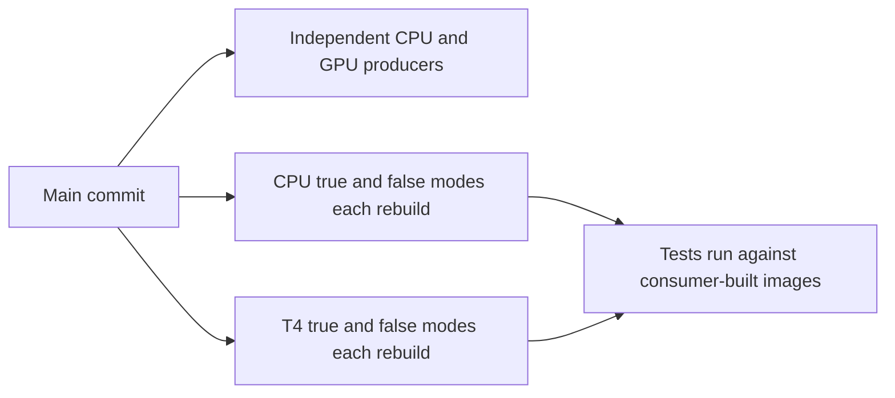
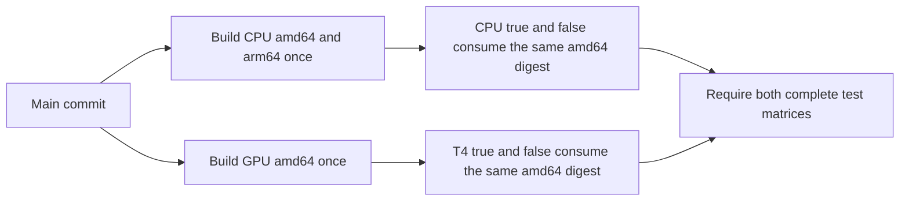

# CPU/GPU CI image reuse

## Implementation plan

**Author:** [PR #3200 author](https://github.com/roboflow/inference/pull/3200)

**Related PR:** [#3200](https://github.com/roboflow/inference/pull/3200)

This plan follows the [contribution template](implementation-plan-template.md).
The team has agreed to the approach, as confirmed by the PR author. Private
discussion details are intentionally omitted. Infrastructure configuration and
live validation remain required before activation.

### 1. What problem are we solving?

Maintainers need both server test modes to validate the images produced for a
main commit without rebuilding identical source in every consumer. Today, a
single main push starts independent CPU/GPU producers plus two CPU and two T4
consumer legs, each of which builds its own image. Passing tests therefore do
not identify the separate producer artifacts, and consumers repeat build work.

### 2. How will the behaviour change?

Before, the same main push fans out to independent builds:



After activation, the same main push connects producers and consumers:



`ci_image_reuse.yml` coordinates the standard server image builds and tests for
one main commit. CPU builds amd64 and arm64 in one producer invocation; GPU
builds amd64 once. The existing CPU and T4 workflows each run both
`USE_INFERENCE_MODELS` modes against their producer's amd64 digest. T4 retains
the complete existing selection, including runtime checks and all model stages.
The separate models-GPU, package, parallel-server and other workflows continue
independently.

Consumers pull by digest, verify architecture and the source revision label,
then run by local image ID. Failed pulls never trigger a replacement build.
Test containers have job-specific names and dynamically allocated loopback
ports. The CPU PyTorch runtime check is retained in the consumer. CPU arm64 is
built but is **not runtime-qualified** by these x86 tests.

The existing reusable test workflows retain their suites and manual inputs,
which keeps the change compatible with fast-track callers. Offline contract
tests and workflow linting verify the wiring; the live trial described below
must verify transport and timing before activation.

### 3. Uncertainties and decisions needing input

| Question | Investigation | Recommendation | Input needed |
| --- | --- | --- | --- |
| Which approved private transport and identities should be used? | Existing producer configuration does not establish a private CI boundary; the new path accepts only external secret parameters. | Use an approved private namespace and separate scoped OIDC reader/writer identities. | Infrastructure maintainers must designate the configuration owner and verify access and retention before activation. No credential values belong in this plan. |
| Are runners and builder caches sufficiently isolated? | Unique container names and loopback ports prevent accidental naming/port collisions; they cannot isolate jobs sharing a Docker daemon. | Use isolated ephemeral runners and a trusted builder/cache boundary. | Runner and builder owners must confirm isolation before activation. |
| Which required-check names should protect main? | The orchestrator adds caller prefixes to reusable job names and introduces an aggregate image-test check. | Review protection expectations while retaining all independent required suites. | Repository maintainers must approve the required-check mapping before activation. |
| Does reuse improve end-to-end duration? | Offline tests verify routing and failure handling, not transfer costs or GPU queueing. | Measure the complete candidate path and GPU occupancy in a full-coverage trial. | An authorized trial is required; no numerical performance claim is made. |
| What qualifies CPU arm64 for release? | Existing server consumers execute on amd64 only. | Retain the arm64 build and report it separately from tested amd64 images. | Release maintainers must define runtime coverage before treating a multi-platform image as release-qualified; this does not block preparing the reuse path. |

OIDC trust verification is required before configuring the OIDC secrets. The
remaining infrastructure decisions block activation, not preparation of the
disabled implementation.
The team discussion required by
[AGENTS.md](../AGENTS.md#internal-contributions-roboflow-team-only) has been
confirmed by the PR author; code review and the activation prerequisites still
apply.

## Change record — Unreleased

### Review fixes

- Preserve Buildx state until its post-job cleanup by removing only Docker
  credentials, preventing orphaned builder containers on persistent runners.
- Keep image-reuse tests explicitly scheduled in the GitHub Actions validation
  workflow after incorporating the hosted-E2E changes from main.
- Restore `fail-fast: true` for both consumer matrices, including private-image
  runs. A failed mode cancels its sibling; the aggregate gate still fails.
- Reject external repository callers and unsupported events before allocating
  runners in the CPU/GPU build and test entry points.
- Require verified OIDC provider and identity restrictions before configuring
  the OIDC secrets; disclose job-wide token permissions even with reuse off.
- Defer helper annotations for Python 3.9 import compatibility, and preserve
  the runner's Docker configuration on legacy consumer paths. Only private
  consumers initialize and clean temporary registry credentials.
- Cover CPU and GPU producer manifests, source labels, platform selection,
  complete digest outputs and invalid producer identities with offline tests.

### Added

- Add opt-in CPU/GPU producer-to-consumer reuse by immutable digest, preserving
  both model modes and the existing server test scope.
- Validate artifact identity, isolate test container names and host ports, and
  require complete producer/test results before the aggregate check passes.
- Parameterize credentials, restrict the new transport to trusted main runs,
  and pin external actions in the affected workflows to verified commit SHAs.

This is a CI infrastructure change. It changes no runtime package, execution
engine behavior, package dependency or release version. The package-specific
`Unreleased` requirements in [AGENTS.md](../AGENTS.md#versioning) and the
[engine rule](../.cursor/rules/execution-engine-version-changelog.mdc) therefore
do not require entries in package changelogs or version bumps for this PR.
This section records the CI change without assigning it to a package release.

## Configuration and activation

The implementation is disabled until the repository variable
`CI_IMAGE_REUSE_ENABLED` is exactly `true`. With it unset or false, the existing
main producer and consumer jobs continue. With it true, those four independent
main jobs skip and the orchestrator owns their builds and tests. Same-repository
release and manual/fast-track entry points remain available.

The flag does **not** disable every change in this PR. The CPU and T4 `build`
jobs and their `server-cpu` / `t4` fast-track callers grant `id-token: write`
even with reuse off. Every step in those jobs can request an OIDC token,
including dependencies and tests. Skipping the authentication step or deleting
Docker credentials does not revoke that ability. Cloud-side trust must reject
tokens outside the approved private-image path. Repository/event guards,
action pins and isolated container names/ports also apply with the flag off.
Legacy consumers preserve the runner's Docker configuration, including Docker
Hub authentication and CLI plugins. Private credential cleanup applies only
after successful private configuration initialization. Both consumer matrices
retain `fail-fast: true`.

### Required before configuring OIDC secrets

Before populating `CI_WIF_PROVIDER`, `CI_REGISTRY_READER` or
`CI_REGISTRY_WRITER`, the infrastructure owner must enforce and verify the
provider condition and service-account bindings below. Apply restrictions
before granting access, not merely before enabling image reuse. These resource
names are not a security boundary even when stored as GitHub secrets.

The provider must accept only the expected GitHub issuer/audience and trusted
repository identity, main ref, push/manual event and orchestrator. The following
CEL template uses public workflow paths; substitute the numeric repository and
owner IDs through the private infrastructure configuration, never credentials:

```cel
assertion.repository == 'roboflow/inference'
&& assertion.repository_id == '<EXPECTED_REPOSITORY_ID>'
&& assertion.repository_owner_id == '<EXPECTED_OWNER_ID>'
&& assertion.ref == 'refs/heads/main'
&& assertion.event_name in ['push', 'workflow_dispatch']
&& assertion.workflow_ref == 'roboflow/inference/.github/workflows/ci_image_reuse.yml@refs/heads/main'
&& has(assertion.job_workflow_ref)
&& assertion.job_workflow_ref in [
  'roboflow/inference/.github/workflows/ci_image_build.yml@refs/heads/main',
  'roboflow/inference/.github/workflows/integration_tests_inference_server_x86.yml@refs/heads/main',
  'roboflow/inference/.github/workflows/test.nvidia_t4.yml@refs/heads/main'
]
```

Map `attribute.job_workflow_ref` from `assertion.job_workflow_ref` and restrict
the `roles/iam.workloadIdentityUser` bindings separately:

- Writer identity: only the exact `ci_image_build.yml@refs/heads/main` workflow
  above may impersonate it; grant write access only to the approved CI registry.
- Reader identity: only the two exact consumer workflow references above may
  impersonate it; grant read-only access only to that registry.

The provider's three-workflow allowlist alone does **not** separate writer and
reader access. Do not grant either identity to the entire pool or to a broad
repository-only principal set. Review all alternative/inherited access paths;
no writer access to release registries is permitted.

For reusable jobs, repository/ref/event and `workflow_ref` describe the caller;
`job_workflow_ref` identifies the called workflow. Thus a foreign repository
calling this public reusable workflow must still fail the repository check.
Direct consumer dispatches, fast-track calls and unrelated main workflows also
fail the orchestrator condition. Numeric identity checks protect against name
reuse. See [GitHub OIDC claims](https://docs.github.com/en/actions/how-tos/secure-your-work/security-harden-deployments/oidc-with-reusable-workflows)
and [Google deployment federation guidance](https://docs.cloud.google.com/iam/docs/workload-identity-federation-with-deployment-pipelines).

Before configuring the secrets, validate allowed producer/reader identities and
denial for external repositories, forks, PR/PR-target events, non-main refs,
wrong callers, missing/wrong reusable-workflow claims and consumer-to-writer
impersonation. Keep policy inspection and validation evidence private; report
only pass/fail in public. Repository tests cannot verify deployed cloud IAM.

### Workflow execution boundary

CPU/GPU build and consumer jobs require `github.repository` to be
`roboflow/inference`, including non-private calls. Consumer jobs accept only
push and manual-dispatch events; legacy producers additionally accept release
events. The fast-track entry point requires a same-repository manual dispatch.
These job guards run before runner allocation and reject cross-repository
reusable calls, fork pushes and PR/PR-target callers. The private producer and
Python transport additionally require main and the enabled rollout flag.

This protects the affected image workflows; it does not disable ordinary public
PR checks elsewhere in the repository. A fork owner can edit their own copy of
the YAML, so cloud IAM must independently enforce the signed token claims.

### Configuration and activation after trust verification

Configure these GitHub **secret parameters** outside the repository. Never put
their actual values in source, issues, public summaries or examples:

| Parameter | Purpose |
| --- | --- |
| `CI_REGISTRY_PREFIX` | Approved private Artifact Registry namespace, in `HOST/PROJECT/REPOSITORY` form, without a trailing slash |
| `CI_WIF_PROVIDER` | OIDC workload identity provider resource |
| `CI_REGISTRY_WRITER` | Identity with write access restricted to the CI repository |
| `CI_REGISTRY_READER` | Separate identity with read-only access to that repository |
| `CI_DEPOT_PROJECT` | Approved builder project and cache boundary |

The registry namespace contains `inference-ci-cpu` and `inference-ci-gpu` images.
Transport tags include source SHA, run ID and attempt. They are retention
anchors; consumers use platform digests. Release registries, Docker Hub
credentials, `latest`, version tags and RC tags are not used by this path.

Before activation, the infrastructure owner must confirm private access at both
repository and inherited policy levels, retention long enough for failed-job
retries, and that the previously verified OIDC restrictions remain in force.
Restrict the builder/cache trust boundary likewise. Use
isolated ephemeral runners; unique container names do not provide isolation
from another job with access to the same Docker daemon. Configure no credentials
or private assets for untrusted PR jobs.

The current T4 runner's lifecycle has not been verified. Private image layers
remain in the daemon after container cleanup. Before enabling reuse, the runner
owner must verify destruction of the VM/daemon and image storage after each
job. A persistent shared daemon is not an approved private-image execution
boundary. Deleting a local image ID cannot establish that isolation and can
race another matrix leg using the same image.

Registry access tokens currently use the authentication action's
[default one-hour lifetime](https://github.com/google-github-actions/auth#inputs-generating-oauth-20-access-tokens),
while producer jobs allow up to two hours. Before activation,
measure cold-cache build, push and manifest inspection from authentication to
completion and require them to fit within the token lifetime with margin. If
they do not, keep reuse disabled until an approved token-refresh design or
supported extended-lifetime policy is implemented and tested. Increasing the
job timeout alone does not extend authentication. Expiry fails the run closed.

Do not enable the switch with missing or unverified configuration. Once enabled,
configuration errors fail closed; they do not fall back to public registries or
the previous independent builds. Review required-check names before activation:
reusable jobs acquire the orchestrator's caller prefixes. This change does not
modify repository protection settings.

## Credential and output handling

Authentication uses short-lived OIDC-derived access tokens, passed to Docker
through stdin. Reader jobs receive only reader configuration and the existing
test secret parameters; producer jobs receive no test or Docker Hub secrets.
Generated authentication files are disabled. Private producers and consumers
place Docker credentials in an isolated temporary directory. Cleanup runs only
after successful initialization and removes only `config.json` before tests
and on job completion, preserving Buildx builder records for the action's
post-job cleanup. Legacy consumers do not override or delete the runner's
Docker configuration; existing login-action post hooks retain their cleanup
responsibility. The private temporary directory is left to runner cleanup; it
is not removed by a normal step before action post hooks run.
Existing test credentials are passed through step environment parameters rather
than interpolated into shell code.

Producer context is a `git archive` of the exact candidate, rather than the
working directory. Runner credentials, generated logs and untracked files
cannot enter that context. Subprocess build/pull/inspection output is withheld
from public logs, including on failure. No private build record, image archive,
SBOM or test data is uploaded as a GitHub artifact. Minimal provenance remains
with the image in its configured registry. Detailed transport diagnostics are
not retained by this workflow; investigate through the approved private builder
and registry tools. Do not enable public debug tracing to retrieve them.

Digest outputs and the public commit/run identity are not credentials and are
used to connect the jobs. Public summaries contain only coverage/status text.
Existing test output still follows the server suites' logging behavior; review
that output before introducing additional private test data. Secret masking is
not a substitute for keeping secrets out of application logs.

## Completion and retries

The aggregate `CPU and GPU image tests complete` check requires both producers,
both complete test matrices and all required platform digest outputs. Failure,
missing output, skipped work or cancellation prevents it from passing. Matrix
fail-fast is explicitly enabled for both consumers on every path. A failed model
mode cancels its queued/running sibling to limit wasted compute. Cancellation
cannot pass the aggregate gate; a successful run still requires both modes.
Full diagnostics from both failing modes are not guaranteed in a single run.

Use **Re-run failed jobs** to retain successful producer outputs and retest the
same images. Re-running every job creates a new producer attempt and may produce
different images, even for the same source SHA. Retention must preserve previous
attempts' manifests. Do not substitute a tag or silently rebuild a missing image.

This is a server-image test gate, not full release qualification. Other required
checks, ARM64 runtime policy, detailed private qualification evidence and RC
promotion remain separate. Existing preprocessing stages are preserved; the
pre-existing Make target does not forward `USE_PYTORCH_FOR_PREPROCESSING`, so
distinct effective preprocessing configurations still need a separate fix.

### Changing the rollout flag

The independent workflows read the repository variable separately; the choice
is not atomic across workflows. Never change it while a main candidate is
queued, starting or running. For **both enabling and disabling**:

1. Pause merges/pushes to main and new manual dispatches for these workflows.
2. Wait for all affected queued/running workflows to finish or cancel them.
3. Change the flag while that pause remains in effect.
4. Resume with a controlled main candidate and verify the expected producer and
   consumer jobs actually executed. When reuse is enabled, require the aggregate
   image-test check to run and pass; skipped jobs are not qualification evidence.

If the pause cannot be guaranteed, do not toggle the flag. This is an operational
constraint, not an atomic rollout implemented by the code.

Rollback sets `CI_IMAGE_REUSE_ENABLED` to false for subsequent runs, restoring
the previous independent main builds, including CPU's existing mutable `:test`
publication. Do not toggle it while a candidate is running: finish or cancel
that run first so old and new jobs cannot overlap unpredictably.

## Validation

Offline checks (no registry writes, GPU execution or test credentials):

```sh
python .github/scripts/test_ci_image.py
python .github/scripts/check_workflow_concurrency.py
actionlint
```

The existing GitHub Actions validation workflow discovers `test_ci_image.py`
with the other script tests. Tests cover malformed/conflicting inputs, legacy
tags, trusted-source checks, identity mismatches, pull failures, platform
manifests, single producer invocation, private-output suppression, isolated
ports, unchanged test scope and incomplete aggregate outcomes. Producer checks
cover CPU indexes, GPU indexes and plain manifests, source labels, exact platform
selection, all digest outputs and invalid run/builder configuration. Consumer
checks execute cleanup steps and verify legacy Docker configuration survives
both non-private runs and private initialization failures. The helper also
imports successfully on Python 3.9; this does not qualify the complete test suite
or establish the actual GPU runner's Python version.

Before rollout, run an explicitly authorized full-coverage trial against the
approved private transport. Verify permissions, real digest pulls, runtime
identity, cleanup, retries and required-check names. Measure producer export,
consumer pull, GPU occupancy and complete candidate duration. Offline checks do
not establish performance gains or production registry/runner compatibility.
