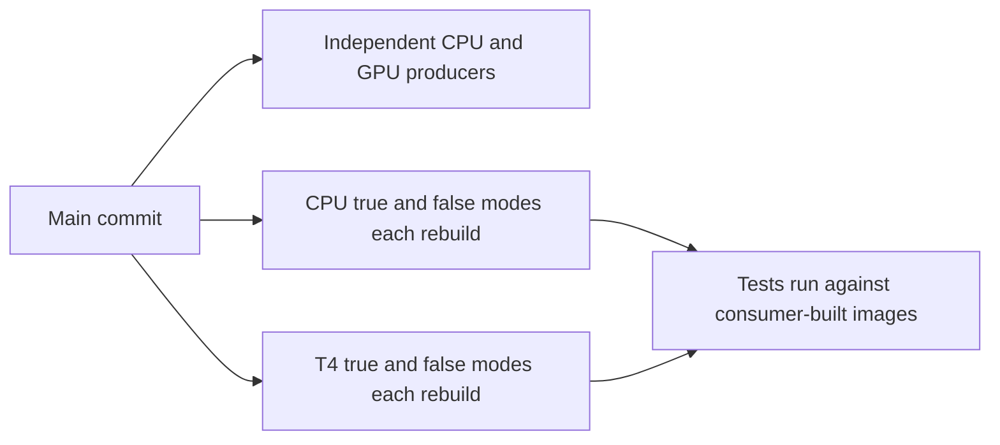
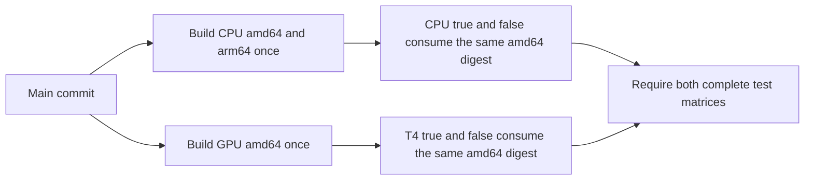

# CPU/GPU CI image reuse

## Implementation plan

**Author:** [PR #3200 author](https://github.com/roboflow/inference/pull/3200)

**Related PR:** [#3200](https://github.com/roboflow/inference/pull/3200)

This plan follows the [contribution template](implementation-plan-template.md).
The team has agreed to the approach, as confirmed by the PR author. Private
discussion details are intentionally omitted. Infrastructure configuration and
live validation remain required before activation.

### 1. What problem are we solving?

Maintainers need both server test modes to validate the images produced for a
main commit without rebuilding identical source in every consumer. Today, a
single main push starts independent CPU/GPU producers plus two CPU and two T4
consumer legs, each of which builds its own image. Passing tests therefore do
not identify the separate producer artifacts, and consumers repeat build work.

### 2. How will the behaviour change?

Before, the same main push fans out to independent builds:

After activation, the same main push connects producers and consumers:

`ci_image_reuse.yml` coordinates the standard server image builds and tests for
one main commit. CPU builds amd64 and arm64 in one producer invocation; GPU
builds amd64 once. The existing CPU and T4 workflows each run both
`USE_INFERENCE_MODELS` modes against their producer's amd64 digest. T4 retains
the complete existing selection, including runtime checks and all model stages.
The separate models-GPU, package, parallel-server and other workflows continue
independently.

Consumers pull by digest, verify architecture and the source revision label,
then run by local image ID. Failed pulls never trigger a replacement build.
Test containers have job-specific names and dynamically allocated loopback
ports. The CPU PyTorch runtime check is retained in the consumer. CPU arm64 is
built but is **not runtime-qualified** by these x86 tests.

The existing reusable test workflows retain their suites and manual inputs,
which keeps the change compatible with fast-track callers. Offline contract
tests and workflow linting verify the wiring; the live trial described below
must verify transport and timing before activation.

### 3. Uncertainties and decisions needing input

| Question | Investigation | Recommendation | Input needed |
| --- | --- | --- | --- |
| Which transport should carry saved images? | The GCP Artifact Registry path designed first was never provisioned and would place CI images next to production-serving images. Depot Registry is project-scoped and OIDC-authenticated through the existing org-level connection. | Save and pull CI images in Depot Registry under a dedicated `inference-ci` project; leave GCP Artifact Registry to release publishing and the existing `inference` project to release builds. | None: the project IDs are literals in the orchestrator, like every other Depot workflow here. |
| Are runners and builder caches sufficiently isolated? | Unique container names and loopback ports prevent accidental naming/port collisions; they cannot isolate jobs sharing a Docker daemon. | Use isolated ephemeral runners and a trusted builder/cache boundary. | Runner and builder owners must confirm isolation before activation. |
| Which required-check names should protect main? | The orchestrator adds caller prefixes to reusable job names and introduces an aggregate image-test check. | Review protection expectations while retaining all independent required suites. | Repository maintainers must approve the required-check mapping before activation. |
| Does reuse improve end-to-end duration? | Offline tests verify routing and failure handling, not transfer costs or GPU queueing. | Measure the complete candidate path and GPU occupancy in a full-coverage trial. | An authorized trial is required; no numerical performance claim is made. |
| What qualifies CPU arm64 for release? | Existing server consumers execute on amd64 only. | Retain the arm64 build and report it separately from tested amd64 images. | Release maintainers must define runtime coverage before treating a multi-platform image as release-qualified; this does not block preparing the reuse path. |

The remaining infrastructure decisions are tracked here; none of them blocks
the implementation.
The team discussion required by
[AGENTS.md](../AGENTS.md#internal-contributions-roboflow-team-only) has been
confirmed by the PR author; code review and the activation prerequisites still
apply.

## Change record — Unreleased

### Depot Registry transport

- Replace the GCP Artifact Registry producer/consumer transport with Depot
  Registry: `ci_image_build.yml` saves each image once with `depot build
  --save` under GitHub OIDC, and the CPU/T4 consumers pull the exact digest
  with a one-hour read-only `depot pull-token`. No registry secret, service
  account or Depot token is stored; the orchestrator passes one Depot project
  ID to every producer and consumer: `inference-ci` on pushes to main, the
  `manual-inference-ci-test` sandbox by default on a manual dispatch.
- Allow a manual dispatch of the orchestrator from any same-repository branch
  so the whole path can be proven before a change reaches main. Dispatches
  default to the sandbox project and the transport refuses the CI and release
  projects on anything but a push, so manual runs never share a registry or
  cache with the main process.
- Remove the push trigger from the release build workflows; on a push to main
  their jobs never published and now skip entirely.
- Supersede the manual fast-track Depot trial: release branches prove the
  same path by dispatching the orchestrator, so the trial workflows, their
  approval variables and reviewer environments are removed.
- Keep release publishing to GCP Artifact Registry unchanged; it serves
  deployments and is not involved in CI image reuse.

### Review fixes

- Preserve Buildx state until its post-job cleanup by removing only Docker
  credentials, preventing orphaned builder containers on persistent runners.
- Keep image-reuse tests explicitly scheduled in the GitHub Actions validation
  workflow after incorporating the hosted-E2E changes from main.
- Restore `fail-fast: true` for both consumer matrices, including private-image
  runs. A failed mode cancels its sibling; the aggregate gate still fails.
- Reject external repository callers and unsupported events before allocating
  runners in the CPU/GPU build and test entry points.
- Disclose that `id-token: write` is job-wide on the producer and consumer
  jobs; the Depot projects' trust relationships decide what the token is worth.
- Defer helper annotations for Python 3.9 import compatibility, and preserve
  the runner's Docker configuration on legacy consumer paths. Only saved-image
  consumers use a temporary registry configuration, removed before tests.
- Cover CPU and GPU producer manifests, source labels, platform selection,
  complete digest outputs and invalid producer identities with offline tests.

### Added

- Add CPU/GPU producer-to-consumer reuse by immutable digest on every push to
  main, preserving both model modes and the existing server test scope.
- Validate artifact identity, isolate test container names and host ports, and
  require complete producer/test results before the aggregate check passes.
- Authenticate with GitHub OIDC, restrict the transport to pushes to main and
  manual dispatches of the orchestrator, and pin external actions in the
  affected workflows to verified commit SHAs.

This is a CI infrastructure change. It changes no runtime package, execution
engine behavior, package dependency or release version. The package-specific
`Unreleased` requirements in [AGENTS.md](../AGENTS.md#versioning) and the
[engine rule](../.cursor/rules/execution-engine-version-changelog.mdc) therefore
do not require entries in package changelogs or version bumps for this PR.
This section records the CI change without assigning it to a package release.

## Configuration and activation

There is no switch. Every push to main runs the orchestrator, which builds each
family once and tests both model modes against that digest; the standalone CPU
and T4 jobs and the push-triggered release builds skip on pushes to main.
Same-repository release and manual entry points remain available, and a manual
dispatch of **Main CPU and GPU image reuse** from any same-repository branch
runs the complete path before a change reaches main. Reverting the orchestrator
change restores the independent builds.

The CPU and T4 `build` jobs and their `server-cpu` / `t4` fast-track callers
grant `id-token: write`, as every other Depot workflow in this repository does.
Every step in those jobs can request an OIDC token; the org-level Depot
connection decides what that token is worth. Repository/event guards, action
pins and isolated container names/ports apply on every path. Both consumer
matrices retain `fail-fast: true`.

### Transport

| Stage | Mechanism |
| --- | --- |
| Producer (`ci_image_build.yml`) | `depot build --save` on Depot builders; GitHub OIDC authenticates the CLI; the saved image is addressed by digest under `registry.depot.dev/<project>`, labelled with the source revision and family, and tagged `ci-<family>-<sha>` so it is readable in the Depot Registry UI |
| Producer manifest check | `depot pull-token` (one hour, read-only) for `docker buildx imagetools inspect` in an isolated `DOCKER_CONFIG` that is removed afterwards |
| Consumers (CPU x86, T4) | `depot pull-token` in a temporary `DOCKER_CONFIG`, `docker pull` by digest, verification of OS, architecture, `RepoDigests`, revision and family labels, then tests by local image ID |
| Retention | Depot project image retention policy |

The Python transport (`depot_ci_image.py`) additionally requires
`roboflow/inference`, a push to `refs/heads/main` or a manual dispatch of the
orchestrator from a `refs/heads/` ref, the orchestrator as
`GITHUB_WORKFLOW_REF`, a project ID of the form `[a-z0-9]+` that is neither the
CI project nor the release project unless the event is a push, and a checkout
equal to `GITHUB_SHA`.

### Workflow execution boundary

CPU/GPU build and consumer jobs require `github.repository` to be
`roboflow/inference`, including non-private calls. Consumer jobs accept only
push and manual-dispatch events; legacy producers additionally accept release
events. The fast-track entry point requires a same-repository manual dispatch.
These job guards run before runner allocation and reject cross-repository
reusable calls, fork pushes and PR/PR-target callers. GitHub issues no
`id-token` to pull requests from forks; which identities Depot accepts is
governed by each project's trust relationships in Depot, not by this
repository.

### Configuration

None. Pushes to main save images in Depot project `inference-ci`
(`9x3fbbxlnm`), whose image retention policy is 7 days; the sandbox keeps
images for 1 day. A manual dispatch of the orchestrator takes a `depot_project`
input that defaults to `manual-inference-ci-test` (`7m01vtml7h`), the team sandbox for
CI experiments, so manual runs never share a registry or cache with the main
process. Both IDs are literals in `ci_image_reuse.yml`.

Activation order: dispatch the orchestrator from the branch and confirm both
producers and all four consumer legs pass, set the retention window, then
merge; the next push to main already reuses images.
