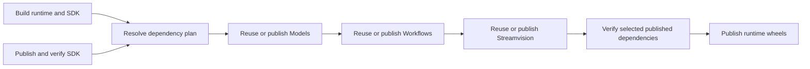

# Implementation plan: dependency-first publication

Author: Michal Taraszewski

Stacked on the SDK publisher split: https://github.com/roboflow/inference/pull/3374
at 4c039331269ab809effccac5bce078c58b711dd8. Target that PR's branch until it merges.

## 1. Problem

The SDK publisher verifies the exact SDK before publishing the five runtime
distributions. Models, Workflows and Streamvision still publish independently on a release
event. A consumer can become available before its required upstream versions,
and operators must coordinate manual releases themselves.

## 2. Behavior

The existing publish.pypi.yml owns full-release coordination as well as the SDK
and runtime uploads. It builds the runtime wheels, reads their Requires-Dist,
and selects a compatible closure of the four first-party dependencies. Existing
non-yanked universal wheels are preferred; an unpublished same-checkout package
version is eligible only when no published version satisfies the constraints.
Exact pins, ranges, extras and prerelease constraints remain authoritative.
Every internal dependency declared by an extra is checked too. No source version,
dependency floor or lock file is changed by the planner.

Only missing versions selected by the plan are dispatched, in topological order.
Uploads remain in the existing trusted workflow files. The coordinator uses
GitHub's workflow_dispatch API with return_run_details, waits for the exact
returned run, checks its revision and conclusion, then independently verifies
the actual published wheel and metadata before continuing. It has Actions write
permission and no OIDC permission. Child workflows check the expected revision
and version before building or publishing. A moved branch, failed/cancelled run,
registry error, incompatible metadata or timeout stops consumer publication.

The standalone workflows lose their automatic release trigger, avoiding duplicate
uploads; full releases dispatch them when required. Their manual build-only and
publish controls remain. Manual publishers verify the dependencies of their built
wheels too. SDK-only mode skips dependency planning and runtime work. Runtime-only
mode still requires the SDK to be prepublished. Build-only runtime/all/dependencies
mode emits a plan without dispatching publishers or uploading anything.

The new packages=dependencies mode builds the same inventories and publishes
only the SDK and required standalone dependencies. It prepares dependencies
before image validation and GitHub Release creation, preserving the full release
process. Runtime partial-upload recovery is outside this change.

The plan and registry receipts are retained with revision, workflow run IDs,
versions and hashes. Runtime publication verifies the plan again immediately
before upload. The SDK retains its stricter same-candidate content verification.
Dependency reuse verifies registry hashes and wheel identity/dependency metadata;
it does not pretend that an already released dependency was built from this checkout.

### Tests

Docker-only local tests cover exact pins and ranges; reuse versus a missing
same-checkout version; constraint conflicts and transitive dependencies; optional
extras and RC selection; yanked/missing/corrupt files; registry failures; dependency
cycles; ordered dispatch; failed/cancelled/wrong-revision child runs; ref movement;
dry runs with no mutations; final verification against the built consumer; and
workflow ownership/permissions. Real runtime wheel metadata feeds the planner in
an integration test. Representative mutations must fail the boundary tests.
Run the existing SDK release contract tests, formatting, actionlint and
concurrency checks.

## 3. Decisions and limits

- Preserve existing PyPI trust; no new publisher registration or API token.
- Require universal pure-Python dependency wheels, matching these four projects.
  Check all declared internal dependencies including optional extras; conflicting
  conditional constraints fail conservatively rather than silently omitting an edge.
- General per-file retry recovery is outside this change. Existing standalone
  skip-existing behavior is unchanged; malformed/partial dependency releases fail verification
  rather than authorizing a replacement upload. Runtime partial-upload retries
  remain manual. Coordinator cancellation can leave an already-dispatched child
  running, but starts no subsequent consumer.
- Manual review triggers remain with the user. No production publication or
  deployment is needed to validate this change.
- The contributor retains ownership of maintainer discussion under AGENTS.md;
  this implementation does not send Slack messages.
