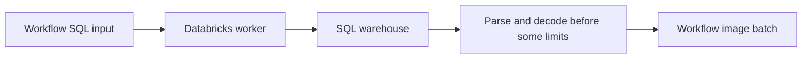
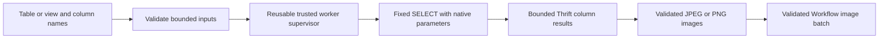

# Implementation plan: bounded Databricks image reads

**Author:** Codex, implementing the scope agreed with Damian Kosowski.

**Related PR:** https://github.com/roboflow/inference/pull/3336

## 1. What problem are we solving?

Customers need to import and pre-label images from Delta tables without a
notebook. The current block accepts arbitrary SQL and has allocation gaps before
its request, image and result limits run. Its subprocess lifecycle is useful to
other trusted integrations but is coupled to Databricks result handling.

For example, reading 100 images from a customer-managed view should require only
connection details, the view and selected columns. It should not accept a second
SQL statement or allocate an unbounded response before checking its size.

## 2. How will the behaviour change?

### Before

### After

- Replace the unreleased raw-SQL interface with separate catalog/schema/table
  names, image/name/metadata columns and the existing row limit. Quote each name
  component and bind it through IDENTIFIER; bind the limit natively. Reject the
  removed sql_statement explicitly. Customers define complex selection in views.
- Extract a supervisor for fixed, trusted worker modules. Bound JSON before full
  serialization, retain the deadline and cleanup lifecycle, and let the caller
  validate/load results while the temporary directory exists. Preserve stdin
  credentials, redaction, and process-wide hook isolation.
- Restrict image parsing to JPEG/PNG before opening the payload. Reject WebP
  until allocation-safe header inspection is available.
- Bound response reads and Thrift strings/containers; refuse HTTP compression
  and Arrow/LZ4 result paths rather than entering unbounded native parsers.
- Update examples, integration/live-test fixtures, changelog and tests. Preserve
  all existing destination, pinning, TLS, redirect and secondary-client guards.
- In a separate draft PR based on this branch, add Databricks admission control
  before worker launch/DNS. Reuse authenticated workspace identity and shared
  infrastructure where available; hosted execution must not silently fall back
  to a process-local limiter. Self-hosted deployments can use local limits.
- In a companion application PR, mask runtime input names equal to token or
  ending in _token, case-insensitively, preserving existing masking and values.

Validation includes meaningful regression tests for hostile identifiers,
pre-allocation rejection, real-connector response bounds, worker cleanup and
cross-request isolation. Real warehouse, final-image and staging checks remain
explicit rollout gates when their infrastructure/credentials are unavailable.

## 3. Uncertainties and decisions needing input

- Hosted admission must use a shared backend and authenticated tenant identity;
  existing host/cache integration points are being inspected. Recommended behavior
  is fail closed when hosted enforcement is configured but unavailable. Numeric
  production quotas and rollout settings remain operator decisions; draft PR
  defaults and their scope will be documented and tested.
- WebP rejection is an intentional compatibility restriction in this unreleased
  block. It closes the demonstrated native-allocation issue without introducing
  a new binary image parser.
- Read-only permission validation and bulk-import checkpointing remain separate
  follow-ups. A subprocess is not an OS sandbox or a guarantee of remote cancel.
- The implementation scope was agreed in the task conversation. No Slack message
  is sent by this task; the internal maintainer discussion/review remains part of
  the draft-PR process.
