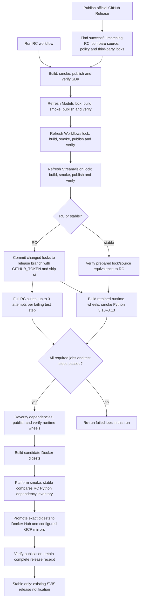

# RC and official release pipeline

`publish.pypi.yml` owns complete RC and stable releases. Reusable test and image
workflows execute as jobs in that run; the release does not dispatch separate
Inference CI runs.

## Operator actions

1. Prepare reviewed package versions and first-party requirement pins on a
   `release-*`, `release/*`, `release-candidates-*`, or `release-candidates/*`
   branch. Third-party dependency changes must already have reviewed lockfiles.
2. **RC: run “Publish Wheels to PyPi” once**, selecting that branch,
   `packages=all`, `publish=true`, and its exact RC version. The workflow publishes
   dependencies, refreshes dependent locks, commits them back, tests, and publishes
   runtime packages/images.
3. Prepare the stable tag from that successful RC, changing only first-party RC
   version metadata to final versions. **Final: publish the official GitHub
   Release once.** The `release: published` event starts the stable pipeline.
   Drafts and GitHub prereleases do not publish stable artifacts.

Version bumps and tag/release creation remain release preparation. CI refreshes
and commits the three dependent `uv.lock` files; it does not choose version bumps.

## Tests and retry behavior

The RC test inventory is `.release/release-policy.json`: static/license checks,
unit, integration, E2E, package installation/isolation and release contract suites.
Existing test matrices are retained. RC pytest steps retry at most three times,
retain every attempt's log, and fail after exhaustion. Normal PR/push test steps
retain one attempt. Static and license failures require fixing the source.

The validation gate rejects failed, cancelled or skipped required suites and
required test steps, including a successful job that skipped its tests. It writes
`Release RC validation` against the generated lock commit without starting CI.

Stable skips the full suites. It requires equivalent tracked source and prepared
locks (allowing only first-party RC-to-final metadata), installs retained wheels,
checks imports/CLI and dependencies, and exercises exact Docker digests on each
platform. Third-party Python inventories must match the RC. This does not assert
bit-for-bit equivalence of rebuilt images or their operating-system packages.

For transient failures use **Re-run failed jobs** on the same RC or stable run.
Successful build jobs retain their artifacts; failed publication jobs reuse those
wheels/digests. Existing PyPI files must match the retained candidate; only missing
files are uploaded. Existing immutable Docker tags must match the retained digest.
An upload error is accepted only when subsequent verification proves publication
completed. A different existing artifact fails closed.

Use failed-job reruns, not “Re-run all jobs”, to recover partial publication.
Rebuilding an already-published version can produce different bytes and is
intentionally rejected. Fixes to code/dependencies require a new RC/version.
There is no rollback of packages or images already published before another job
fails. Receipts/artifacts are retained for 90 days, subject to repository policy;
stable requires the matching RC receipt to remain available.

## Lock commits and source identity

Only `inference_models/uv.lock`, `workflows/uv.lock`, and
`stream_vision/uv.lock` may be generated and committed. The resolver refreshes
selected direct/transitive first-party versions and rejects third-party drift.
The bot uses the workflow's `GITHUB_TOKEN`, a normal non-force push, and `[skip ci]`.
It checks the remote branch before pushing and refuses concurrent changes. A
rerun recognizes its own prior lock commit instead of creating another one.
All subsequent tests and builds explicitly check out the resulting SHA.

Stable restores the prepared lock snapshot in jobs, verifies its equivalence, and
does not mutate the release tag or commit to a branch.

## One-time repository configuration

- Authorize PyPI Trusted Publishing for **`publish.pypi.yml` in
  `roboflow/inference`** on all nine projects: `inference-sdk`, `inference-models`,
  `roboflow-workflows`, `streamvision`, `inference`, `inference-core`,
  `inference-cpu`, `inference-gpu`, and `inference-cli`. Uploads stay in the root
  workflow; the publishing jobs request `id-token: write`. No PyPI token is used.
- Permit the `GITHUB_TOKEN` lock job (`contents: write`) to push to the selected
  release branch. Branch rules requiring a PR, signed commits or prior checks
  can block it. Configure the release branch rules accordingly; this workflow
  does not bypass them. The later aggregate check cannot authorize its own
  earlier push. Validation also needs `actions: read` and `checks: write`.
- Retain existing Docker Hub secrets `DOCKERHUB_USERNAME` and `DOCKERHUB_TOKEN`,
  with write access to the image repositories in the policy. Retain Depot
  project access for this root workflow/reusable image workflow.
- Retain GCP federation for
  `projects/878913763597/locations/global/workloadIdentityPools/github-actions/providers/github`
  and `gha-inference@roboflow-staging.iam.gserviceaccount.com`, with Artifact
  Registry write access to `us-docker.pkg.dev/roboflow-artifacts/roboflow`.
  CPU, GPU and CUDA 13 mirror the exact Docker Hub digest, including all layers
  and platforms. These jobs request `id-token: write`.
- Make the existing test runner groups and inherited test secrets available to
  the root workflow. Docker smoke needs Linux amd64/arm64, the
  `Roboflow-GPU-VM-Runner` label with drivers compatible with the CUDA variants,
  and Jetson runners labelled `self-hosted`, `jetson`, and respectively
  `jetpack-5.1.1`, `jetpack-6.2.0`, `jetpack-7.2.0`. Jetson runners need Docker's
  NVIDIA runtime and current Actions runner/JavaScript action support. Missing
  hardware blocks publication; it does not skip smoke checks.
- Keep existing `svis-dispatch` environment configuration for the downstream
  notification. It now runs only after completed stable publication. If that
  environment requires approval, that remains an additional notification approval;
  configure it without approval if the entire path must be unattended.

The image policy preserves the release image catalog, including Models images
and all existing platform variants. Stable alone advances `latest` (and Models
variant `*-latest`) when GitHub identifies that release as the latest.

Independent SDK/package publishers remain available. Old runtime Docker workflows
retain diagnostic/manual builds, but stable runtime publication belongs to the
root workflow; manual pushes require an RC version or a custom diagnostic tag.
TestPyPI, test Docker repositories and a test Artifact Registry destination are
separate follow-up work; this pipeline currently targets the existing registries.
