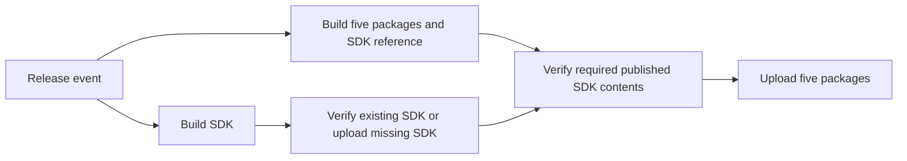

# Implementation plan: independent SDK publication (PR1)

## 1. Problem

Releasing inference-sdk currently uses a six-package publisher. An SDK change
cannot be published by that workflow without also uploading runtime/CLI wheels,
and a manual dispatch publishes immediately. We need a dedicated SDK path while
keeping an ordinary full release functional before later dependency/retry PRs.

## 2. Recommended behavior

Before: release/manual dispatch -> build six wheels -> upload all six.

After:

One existing trusted workflow, `publish.pypi.yml`, offers `packages=sdk`,
`runtime`, or `all` (default). SDK and runtime each have separate build and publish
jobs. Release events select both groups; SDK-only mode skips the runtime jobs.
Runtime-only mode requires an already published SDK. Both OIDC upload jobs stay
in the existing workflow, with no environment, so no PyPI access or new trust
registration is required.

Manual runs default to build-only. Publication requires an expected version
matching source and wheel metadata; release events derive it from the tag.
Separate build/publication jobs limit OIDC to publication and retain original
artifacts. SDK-only publication does not install server/runtime dependencies.

SDK reuse compares every wheel entry, including metadata and permissions, while
ignoring ZIP timestamps/compression. It verifies downloaded bytes against PyPI's
SHA-256. This avoids a dependency on expired historical Actions artifacts and
does not equate a matching name/version with matching package contents. The
receipt identifies the current verification, not an unproven original upload.

The consumer publisher builds a lightweight SDK reference separately from its
five-wheel upload inventory. Runtime-only mode independently verifies a
prepublished SDK. All/release mode waits for the SDK publication job to succeed
before running that registry verification. A missing/conflicting SDK
stops consumers. Generic `make upload_wheels` excludes SDK; existing six-wheel
and production-image build targets retain their behavior.

The shared version and exact SDK pins stay unchanged. Upstream preparation stays
manual per [the release runbook](pypi-release.md). Dependency selection/order
automation is PR2; generalized partial-upload recovery is PR3. They are not
prerequisites for the paths delivered here.

Validation: Docker tests exercise real six-wheel vs split builds, metadata and
inventory checks, matching/conflicting SDK reuse, ZIP timestamp differences,
registry/hash failures, delayed visibility and bounded timeouts. Validate the
three package modes, build-only defaults, failed/skipped/cancelled dependencies,
and preservation of the existing OIDC workflow identity. SDK unit,
integration, E2E and installation workflows execute through Docker. Record exact
image IDs, revisions, commands and results; no host fallback.

## 3. Decisions and rollout prerequisites

- Retain the current workflow filename, repository and absence of an environment
  for both upload jobs. Keep all six existing PyPI trusted-publisher entries.
  The split requires no external publisher configuration change.
- Existing non-SDK host-executed validation is not accepted under the Docker
  policy. Its Docker execution paths are a release prerequisite, not a reason
  to include an unrelated whole-repository CI migration here.
- SDK receipts compare complete contents rather than historical input-fingerprint
  receipts. This is stricter about output equivalence and avoids guessing the
  setup script's transitive input closure.
- Review required checks before merge. No production publication is needed to
  run local regression tests or build-only checks.

The contributor should share this plan for maintainer discussion as required by
AGENTS.md. No Slack message or external publisher configuration is performed by
the implementation itself.
