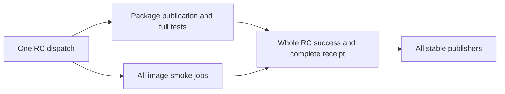
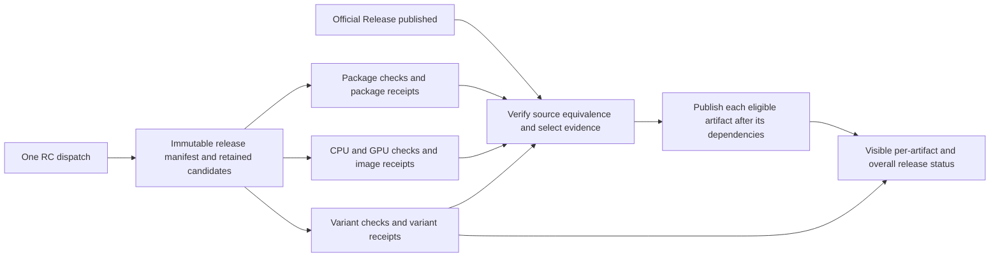

# Implementation plan: recover release orchestration after #3478

**Status:** proposal only; this draft changes no executable code or workflows.
**Author:** Michał / Inference release maintainers (agreement pending).
**Baseline:** `b2b30c072b9c01ac0c15927979dd7da1bc06f9c5`, inspected 2026-11-23.
**Related:** [original #3464](https://github.com/roboflow/inference/pull/3464),
[revert #3478](https://github.com/roboflow/inference/pull/3478),
[final 1.8.6 preparation #3477](https://github.com/roboflow/inference/pull/3477).

This is a design for review, not the operator runbook. The existing local
runbook remains local. Implementation, CI validation and rollout are pending.

## 1. What problem are we solving?

Release maintainers need one RC dispatch to publish dependencies, commit generated
locks and run the full RC suite, followed by one official GitHub Release
publication to trigger stable verification and publication. Normal version,
changelog and RC-to-final metadata preparation still occurs in reviewed source;
there should be no manual per-package dispatch or lockfile repair in the normal
path. Retries must reuse the candidates already tested or partially published.

The reverted design tied all deliverables to a single successful RC workflow.
RC2 published the six SDK/runtime distributions and reused the companion package
versions, but image failures prevented the receipt needed by every stable
publisher. A working Python package could not ship because an unrelated CUDA
image failed. The replacement must preserve validation while isolating failures
at the artifact and actual dependency boundaries.

### Incident evidence and current source

The [incident thread and issues.md attachment](https://roboflow.slack.com/archives/C0BDUJNV1DG/p1795238760077899)
report the following. Historical passes are evidence about those candidates,
not validation of a replacement implementation.

| Finding | Evidence | Consequence for the replacement |
| --- | --- | --- |
| Stable selection filtered RC runs by whole-run success, then required a complete receipt. | [`_find_rc`, incident revision](https://github.com/roboflow/inference/blob/329bb791129e9d9c9d828f0c12597d645c20d0f4/.release/pypi/flow.py#L554-L628) | Select trusted artifact evidence without a whole-run success predicate. |
| Models CUDA 11.8 failed loading `libcudnn.so.8`; UDP GPU smoke could not import `inference`. | [CUDA job](https://github.com/roboflow/inference/actions/runs/44862396213/job/136731367867), [UDP job](https://github.com/roboflow/inference/actions/runs/44862396213/job/136732796053) | Keep both artifacts blocked until their real hardware/runtime smoke passes. Neither failure diagnoses its root cause by itself. |
| Four Jetson smoke jobs were queued at the reported observation. | [RC2](https://github.com/roboflow/inference/actions/runs/44862396213) | Record waiting separately from failed. Scheduling cause remains unestablished. |
| SDK Linux import needed `libgl1` and `libglib2.0-0`. The incident revision added both; current main's release Dockerfile lacks them. | [RC1](https://github.com/roboflow/inference/actions/runs/44839764263), [incident Dockerfile](https://github.com/roboflow/inference/blob/329bb791129e9d9c9d828f0c12597d645c20d0f4/.release/pypi/Dockerfile) | Restore the libraries with a clean retained-wheel import check when restoring smoke execution. |
| Unified publication lacked trust for Models, Workflows and Streamvision. Legacy publishers supplied matching candidates; RC2 reused them. | [authorization incident](https://github.com/roboflow/inference/actions/runs/44840889334) | Existing-version reuse does not prove authorization to upload a new version. Resolve publisher identity before enabling new uploads. |
| PyCUDA needed a GPU runner and CUDA 12.5 development headers. Python 3.10–3.13 smoke then passed. | [verification attempt 2](https://github.com/roboflow/inference/actions/runs/44855819263/attempts/2), [incident workflow](https://github.com/roboflow/inference/blob/329bb791129e9d9c9d828f0c12597d645c20d0f4/.github/workflows/publish.pypi.yml#L470-L518) | Preserve GPU-specific smoke prerequisites without moving unrelated package smoke onto scarce GPU runners. |
| A contract test rejected correctly refreshed dependency floors; it was changed to derive floors from lock metadata. | [failed contract job](https://github.com/roboflow/inference/actions/runs/44840889334/job/136680441908), [revised test](https://github.com/roboflow/inference/blob/329bb791129e9d9c9d828f0c12597d645c20d0f4/.github/scripts/test_release_flow.py#L1050-L1069) | Test manifest/lock/wheel agreement and independent mutations; reading a value twice is insufficient. |

Current main restores the independent release workflows. Its PyPI coordinator
already has dependency ordering and published-file verification in
`pypi/dependencies.py`, `pypi/publish.py` and `pypi/release.py` in this directory.
Reuse these contracts; do not revert the revert wholesale.

## 2. How will the behaviour change?

### Before: the reverted design

With CUDA 11.8 failing or Jetson waiting, the gate has no accepted receipt even
when the packages and standard CPU/GPU images are valid.

### After: one coordinator, independent eligibility

The selection does not wait for every image. Each publication job depends only
on its identity/equivalence checks, its own validation and its dependency closure.
The reporting job is never a prerequisite of publication. Independent matrices
use `fail-fast: false`; `needs` and implicit success conditions must not recreate
the global gate. A queued job cannot prevent another artifact's receipt being
written or selected.

### Release manifest and proposed groups

Freeze a versioned manifest at RC preparation containing artifact IDs, package
versions, dependency edges, test coverage, image platforms/destinations, runner
requirements and classification. Freeze its digest with the candidate. Unknown
artifacts, duplicate IDs, cycles, missing coverage or changed policy fail closed.

The following is a proposed completeness policy, subject to maintainer agreement.
Groups summarize readiness; **they are not additional publication barriers**.
Even a failed required artifact blocks only itself and its consumers, while the
overall required release remains incomplete.

| Group | Inventory | Proposed classification |
| --- | --- | --- |
| Python SDK | `inference-sdk` | Required for core completeness; independent package receipt. |
| Python companions | `inference-models`, `roboflow-workflows`, `streamvision` | Required for core completeness; separate receipts and dependency gates. |
| Python runtime | `inference`, `inference-core`, `inference-cpu`, `inference-gpu`, `inference-cli` | Required for core completeness; separate publication decisions, preserving existing shared-version rules. |
| Standard server images | `cpu` on amd64 and arm64; `gpu` on amd64; all configured registry destinations | Required for core completeness. A multi-platform tag requires every declared platform. |
| Additional server images | `cpu-parallel`, `cpu-slim`, `gpu-parallel`, `gpu-slim`, `gpu-udp`, `gpu-cu13`, `trt` | Scheduled optional variants relative to core completeness; every variant still requires its own full checks. |
| Jetson and Models images | `jetson51`, `jetson62`, `jetson72`; `models-cpu`, `models-cu118`, `models-cu124`, `models-cu126`, `models-cu128`, `models-jp51` | Scheduled optional variants relative to core completeness; hardware evidence remains mandatory. |
| Desktop installers | Windows CPU, Windows GPU, macOS ARM64 DMG | Independently reported desktop group; all three required for desktop completeness, not prerequisites of server artifacts. |

The image keys above preserve the 18 variants in #3464's policy. Audit current
Docker workflows during implementation for omitted release-triggered outputs.
The manually released experimental server/model-manager packages and images,
and Jetson media/wheel base-image maintenance, retain their existing lifecycle;
record any base-image digest used by a release image as an input. Do not silently
enroll those products in this release or discard a supported existing variant.

Optional means independent of core completeness, not untested or ignored. All
scheduled failures remain visible. Exclusion needs an explicit reason in the
reviewed manifest before the RC; never downgrade a failing required artifact
mid-run. Changes to the inventory/classification require a new candidate.

### Dependencies and validation coverage

Resolve edges from retained wheel `Requires-Dist` metadata, applying environment
markers and the extras promised by each artifact profile. Compare them with
source declarations and selected versions. Do not infer dependencies from group
names or make every artifact depend on all packages.

The current first-party graph includes SDK and Models feeding Workflows,
Workflows feeding Streamvision's workflows extra, and SDK/companions feeding
the runtime consumers that require them. SDK and Models may proceed independently.
A missing or mismatched published dependency blocks its transitive consumers.
Image/installer profiles additionally record exact installed package inventories
and base-image/toolchain digests. Preserve separately versioned companion tags.

Keep the full 24-workflow RC suite from the incident policy and Python 3.10–3.13
runtime smoke coverage. Map each check to affected artifacts rather than using
one all-tests-success boolean: shared source/policy/license checks cover all;
SDK checks cover SDK and its consumers; Models, Workflows and Streamvision checks
cover those packages and their consumers; CPU/GPU and image-specific checks cover
the corresponding targets. Independently review the explicit mapping against
existing CI before enabling publication. Unmapped or missing tests are a blocker.

Companion smoke must retain declared interpreter/platform support coverage;
the previous Python 3.12-only companion smoke is not proof of every supported
environment. Expanded coverage can be a separate rollout prerequisite rather
than an unsubstantiated claim that the historical matrix already covered it.

### Evidence contract and retry selection

Write evidence at each artifact boundary, not just after the matrix completes.
Use immutable names incorporating candidate ID, artifact ID, stage and attempt.
Each receipt records schema/policy digest, repository, trusted workflow identity,
trigger SHA, generated source SHA/tree, versions, run/job/attempt IDs, file hashes
or OCI digests, platform, check results, dependency receipt IDs and output
verification. Include failure and waiting records as well as passes.

Validate provenance against GitHub job/run/artifact metadata; an uploaded JSON
claim alone is not authority. A successful job inside a failed or still-running
RC is usable only when all required checks for that artifact completed and its
immutable identity matches. Fork runs, preview builds, unknown workflows,
expired/missing evidence, skipped checks and failed/cancelled checks never grant
eligibility. Receipt schema v1's global `complete` flag is not a v2 artifact pass.

Select one explicit candidate generation per stable release, bound to equivalent
source and policy. If selection is automatic, require a unique eligible generation;
ambiguity blocks selection with a diagnostic. Never combine unrelated RCs just
because their versions match. Within that generation, select the latest scheduled
attempt of each required check. A failed or pending rerun invalidates an older
pass for that check; an unrelated job rerun does not. Retain the original build
artifact ID across attempts and verify its hash before every reuse.

Retries get at most three attempts for retryable test/transport steps, preserving
each failure and the final outcome. Deterministic identity, authorization and
content mismatches stop immediately. Re-run failed jobs reuses retained wheels,
sdists and OCI candidates; it never rebuilds a partially published version or
retags an untested image. Missing/expired candidates require a new build and
validation generation, and a new version if published bytes would differ.
Concurrent retries serialize by destination/artifact/version and cannot overwrite
receipts or published content. Rerunning all jobs must also fail closed on an
identity conflict rather than silently replacing retained candidates.

### RC and stable execution

1. **RC preparation:** validate release-branch/version inputs and resolve the graph.
   For each package in dependency order, verify/publish its upstream candidates,
   refresh its companion `uv.lock` with `uv` before building, then retain,
   smoke-test and publish the candidate. Preserve unrelated third-party selections
   and already-published byte/content comparison. Record each build's input tree
   and prove it matches the eventual generated source for that package.
   Preserve the RC channel guard: new SDK/runtime/companion uploads must have RC
   versions. An already-published final companion version may be reused only
   after exact-content verification; a missing final companion version requires
   preparing a new RC version, not uploading the final during RC preparation.
   RC images use candidate/RC tags only and never move stable or `latest` aliases.
   Commit only those lockfiles with an expected-parent check; branch advancement
   stops the write. Use the repository token's push semantics plus explicit
   workflow guards to avoid an extra CI run. Do not rely on commit text alone.
   All subsequent full-suite tests consume the recorded generated source SHA and
   retained candidates. Consumers never build against a stale pre-refresh lock.
2. **RC validation:** run the complete test inventory with bounded retries and
   independent package/image smoke. Emit receipts immediately. Release tests
   continue even when an unrelated variant fails. A lightweight status reconciler
   reads the expected inventory, so queued, cancelled and never-started jobs appear
   without waiting on their runners or the full matrix.
3. **Stable trigger:** official, non-prerelease `release.published` only. Bind the
   release ID, immutable tag SHA and final versions. Verify RC/final equivalence:
   allow only the declared first-party RC-to-final version/pin transformation;
   reject code, dependency-floor, third-party lock/hash/source, build-input and
   policy changes. Retain the source ref so deleting the release branch cannot
   destroy provenance. Changed code or dependencies require a new RC.
4. **Stable artifacts:** final versions change package metadata, so do not rename
   RC wheels or assume their bytes are final. Build the final candidates once,
   compare normalized payload/metadata to the accepted RC, run actual final-wheel
   smoke and verify final dependencies before upload. Apply an explicitly bounded
   finalization to images containing RC packages; compare the allowed changes,
   retain a new digest and smoke that exact final digest on the required hardware.
   Reuse an existing final image only after its digest/content identity is proved.
5. **Publish and verify independently:** stage only missing files; reject conflicts;
   reread registry/PyPI results and compare hashes, inventories and OCI platform
   manifests. Track each registry destination separately. Partial publication
   is recoverable, not atomic: one successful registry remains recorded when
   another fails, and retries fill only the missing destination. Move mutable
   aliases only after that artifact's required destinations verify, with a
   monotonic-version guard so an older retry cannot regress `latest`.
6. **Report/recover:** maintain `planned`, `waiting`, `failed`, `blocked_dependency`,
   `validated`, `publishing`, `partial`, `published_verified` and `excluded`
   per artifact, with reasons and evidence links. Show core, desktop and all
   scheduled-artifact completeness separately. Any scheduled failure keeps the
   overall summary partial/failing even if core is complete. Do not change
   historical failure records into passes. Stable retries reconcile the same
   release and candidates; late RC evidence requires rerunning blocked stable
   jobs, not republishing the GitHub Release. Report waiting with elapsed time
   and a bounded queue deadline; a deadline blocks only affected artifacts.

## 3. Uncertainties and decisions needing input

| Decision | Investigation and recommendation | Required input / blocking scope |
| --- | --- | --- |
| Required groups and partial publication | The incident proves all-or-nothing coupling is harmful. Recommend the proposed core/desktop/optional split, always exposing incomplete scheduled variants. | Maintainers confirm the supported inventory and classification before implementing promotion policy. |
| PyPI publisher identity | Current companion workflows have individual upload entry points; incident root workflow was unauthorized for new versions. Prefer a single coordinator that automatically invokes the existing authorized publisher entry points with exact retained artifact identity, revision and version guards. They must consume retained candidates rather than rebuild. | Package owners confirm supported caller/entry-point trust configuration; if reusable/root identity differs, configure it explicitly. Prove a genuinely new authorized candidate upload before rollout. No account or permission inspection performed. |
| CUDA 11.8 and UDP root causes | Failure logs establish missing cuDNN and an import failure, not which package/loader/path change fixes them. Reproduce exact candidate digests on compatible GPU hardware and inspect the image's actual interpreter and runtime environment. | GPU validation capacity and a reviewed fix are needed only to enable those variants. They remain blocked meanwhile. |
| Jetson availability | Report showed queued jobs; it did not establish a runner-label, capacity or permission cause. Preserve distinct waiting status and platform-specific runner requirements. | Runner owner supplies scheduling cause and realistic queue deadline before Jetson rollout; do not guess or inspect service accounts. |
| Evidence retention | Existing release artifacts use 90-day retention, while stable recovery can occur later. Recommend retaining immutable candidates/receipts for at least 90 days and through the declared recovery window; explicitly refuse recovery if required material expires. | Maintainers choose a longer durable retention window/store if required. Storage/registry configuration is external work, not inspected here. |

### Related DMG recovery, independently deliverable

On 2026-11-23 the [v1.8.6 release](https://github.com/roboflow/inference/releases/tag/v1.8.6)
contained the CPU/GPU Windows installers and no DMG. The
[macOS run](https://github.com/roboflow/inference/actions/runs/44874084404/job/136754809077)
was cancelled with no steps; its annotation says the `macos-14-arm64-us-default`
configuration is unsupported. Current `build-osx-bundle.yml` uses `macos-14`.
GitHub confirms the [November 2 retirement](https://github.com/actions/runner-images/issues/13518)
and lists [`macos-15` as ARM64](https://github.com/actions/runner-images/blob/main/README.md).
This verifies the missing DMG and runner failure, not every external v1.8.6 artifact.

Prepare a separate small repair: use `macos-15`, pin the v1.8.6 source SHA
`b2b30c072b9c01ac0c15927979dd7da1bc06f9c5`, assert the target release/version,
retain the signed/notarized DMG, and verify architecture, startup, signature and
stapled notarization. The existing manual workflow does not attach a release
asset; recovery needs an explicit, guarded attach path to release ID `453480882`,
checking any existing filename/hash before upload. New workflow code must check
out the historical source explicitly; changing main alone does not repair the
workflow stored at the old tag. Signing configuration and native macOS execution
are external prerequisites. This PR does not run a build, inspect credentials,
attach an asset, or authorize publication. Docker checks cannot prove notarization.

## 4. Implementation and rollout order

| Stage | Concrete change | Exit evidence and safe intermediate state |
| --- | --- | --- |
| 0 — this PR | Agree on the design, scope and policy. | Source/incident review only. Existing workflows remain active. |
| 1 — contract first | Add versioned artifact policy, receipt validator/selector and status reducer, with test-first incident and adversarial cases. Candidate locations: `.release/release-policy.json`, `.release/pypi/flow.py`, `.github/scripts/test_release_flow.py`. | Red tests against the original globally gated selector; green real selector/consumer tests. No publication wiring yet. |
| 2 — package path | Adapt existing dependency coordination and individual publishers to retained artifacts; restore SDK system libraries and GPU-specific wheel smoke; guard automatic lock commits. | Tracked Docker tests plus real retained-wheel tests and exact identity checks. Confirm new-version publishing authorization externally. Legacy path stays selected until ready. |
| 3 — image path | Restore/rework `release.image.yml` and image helper scripts with per-platform/destination receipts and independent smoke. Fix CUDA/UDP separately. | Actual CPU/GPU and Jetson hardware evidence for each enabled variant; failed/unavailable variants explicitly remain blocked. |
| 4 — shadow orchestration | Wire one RC entry point and a read-only stable planner, preserving the full suite. Write receipts and summaries; disable stable mutation in shadow mode. | One complete RC exercise plus injected failure/queue/retry cases through real Actions job boundaries. Compare expected plans and retained artifacts. |
| 5 — controlled switch | Enable stable publishers using v2 evidence and retire overlapping legacy release triggers in the same change. Preserve build-only/manual maintenance modes. | An authorized canary release demonstrates idempotent upload, partial recovery, digest checks and aliases. Exactly one publisher owns each artifact/event. |

Keep the macOS repair independently reviewable; it need not wait for the new
orchestrator. Before substantial structural implementation, share this plan for
maintainer agreement per `AGENTS.md`; no Slack message has been sent by this PR.

Rollback disables the new coordinator and restores reviewed legacy entry points
without rebuilding or deleting immutable releases. Reconcile already-published
files/digests before any fallback dispatch. Do not run both paths simultaneously,
move a final tag, or treat rollback as permission to bypass failed artifact checks.

## 5. Acceptance tests and evidence required

Write the smallest boundary tests first, retain their failing results, then
implement. Parent verification must demonstrate the specific whole-run-gate
failure on the incident implementation; a missing new API on current main is
not that reproduction. Use independent expected inventories and malformed
fixtures, not an expected result produced by the same selector under test.

| Scenario | Required observation |
| --- | --- |
| Replay RC2 outcomes | Passed SDK/runtime/companions and CPU/GPU are eligible despite failed CUDA 11.8/UDP and waiting Jetson. Failed/waiting variants have no promotion actions; summary is partial. |
| Required artifact failure | Other independent required artifacts can publish; its consumers block; required completeness stays false. |
| RC/stable channel separation | New RC versions may upload; an existing final companion is reused only with matching content. A missing final companion version is rejected during RC. RC runs cannot publish stable image tags or move `latest`. |
| Dependency mismatch | A selected dependency's wrong version/hash or unsatisfied marker/extra blocks only the actual consumer closure. No upload side effect occurs for blocked artifacts. |
| Forged/stale evidence | Wrong repository/workflow/SHA/policy, expired artifacts, duplicate/missing platforms, skipped smoke and an earlier pass followed by failure/pending rerun are rejected. An unrelated failed rerun does not erase valid evidence. |
| Stable equivalence | RC-to-final identity edits pass; changed code, first-party floor, third-party hash/index, image input or policy fails. Final wheel/image smoke runs on actual retained final outputs. |
| Lock contract | Run `uv lock --check`; compare pyproject requirements, lock metadata/resolutions and built wheel `Requires-Dist`. Independently mutate each boundary and require failure. A legitimate floor bump with consistent artifacts passes. |
| Guarded lock commit | Only three declared lockfiles change; third-party resolution stays fixed; stale branch parent rejects push; generated commit triggers no duplicate CI; downstream tests use its SHA. |
| Retry after partial upload | Interrupt after a real staged upload boundary in a disposable registry/index fixture. Retry reuses exact artifact IDs/bytes, verifies existing objects and uploads only missing ones. A conflicting object stops publication. |
| Real Actions scheduling | One matrix child fails, one remains queued, one is cancelled, and another succeeds. Receipts/reporting and the eligible stable child proceed without the queued child finishing. Exercise failed-job reruns with prior-attempt artifacts. |
| GPU and UDP regressions | Retained `inference-gpu` wheels install on Python 3.10–3.13 with the CUDA toolchain. CUDA 11.8 executes inference using the required provider, with no CPU fallback; UDP smoke uses the shipped interpreter/entry point and proves startup. |
| Multi-platform/destination output | Missing arm64 blocks only its multi-platform artifact. One registry failure records partial publication; recovery verifies both destination manifests before alias movement. Concurrent/older retries cannot regress aliases. |
| Visibility and cutover | Missing receipts cannot produce a green full-release status. All expected artifacts have state/reason/links; legacy and new triggers cannot double-publish; rollback preserves existing identities. |

Run local tests in Docker through the shared `test-execution-tracking` runner;
retain revision/content digest, image/container IDs, scenarios, run UUID and
`registry_synced: true`. Review the final diff independently after implementation.
Unit mocks and local fixture tests prove control logic only. Hardware, PyPI trust,
native installer signing, GitHub scheduling and live promotion require their
own authorized evidence before claiming release readiness.

**Validation of this draft:** source, incident and release metadata inspection;
no executable changes, no local test payloads, and no claim of release readiness.
