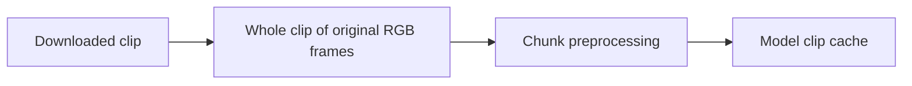

# Bound original-frame memory during SAM3 embedding

Related PRs: [SAM3 tracking #3333](https://github.com/roboflow/inference/pull/3333)
and [restricted decoder #3417](https://github.com/roboflow/inference/pull/3417).
This implementation is stacked on #3417 and reuses its restricted PyAV reader.
The user approved this approach in the originating chat.

## Problem and behavior

A 480-frame UHD clip retains 11.94 GB of original RGB arrays before preprocessing.
The model cache budget does not include these originals. Both HTTP stacks must
stream the submitted file through bounded preprocessing and preserve original
coordinates, clip length, model preprocessing, and the public JSON contract.

## Implementation

- Add optional source-pixel limits to the restricted decoder. Apply codec limits
  during probing and on the decode codec context; validate dimensions before RGB
  conversion. Preserve the playlist restrictions and rotation behavior.
- Default SAM3 limits: 64 MiB retained RGB input, 16,777,216 source pixels per
  frame, and at most 16 frames per preprocessing batch. Reject invalid settings.
- Pass an internal owned file source through the current local/threaded model
  call. It opens no user-provided paths. Cancelling the request closes an idle
  source or requests cancellation of an active source; only its consumer closes
  an active handle. The temporary pathname may be removed safely after handoff.
- One embedding operation per process owns admission through actual completion,
  including cancelled requests. Waiting operations do not decode original frames.
- Reserve cache capacity before allocating processed frames. Commit only complete
  clips and release reservations and partial tensors on every failure.
- Keep direct list callers supported. The HTTP path never materializes the clip.
  The internal source is not an IPC representation: rf-serving transport remains
  stage 3 and must carry the encoded input with explicit ownership.

## Validation and limits

Exercise real media, pixel limits, bounded live original arrays, lying/unknown
counts, changing dimensions, cleanup/cancellation and concurrent admission;
compare chunk preprocessing with the existing real HF processor and cover both
HTTP stacks. Re-run #3417 decoder and action-recognition regression suites.

The RGB budget is not an RSS ceiling. Native decoder reference frames, conversion
scratch, processor copies and model state require separate deployment headroom.
Cache eviction also does not free clips pinned by active tracking requests.
Production memory profiling and GPU validation remain necessary before enabling
hosted video tracking. No additional deployment or rf-serving changes are made.
