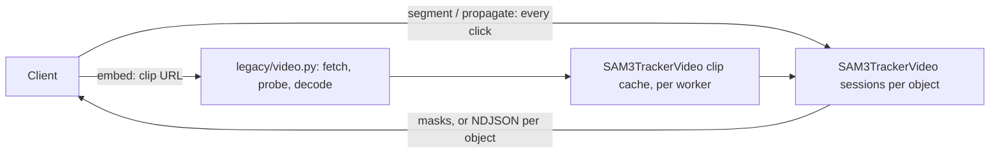

## Implementation plan: SAM3 offline video tracking routes

**Author:** Peter Robicheaux

**Related issue / PR:** branch [`peter/sam3-video-api`](https://github.com/roboflow/inference/tree/peter/sam3-video-api) (PR to follow)

## 1. What problem are we solving?

Interactive video annotation with SAM3: a user clicks the objects they want
in a clip, and SAM3 tracks those objects through the whole clip. They fix
the track by clicking again on any frame where it drifts, then track again.

What's missing today: the hosted SAM3 video path (the WebRTC workflow block)
prompts on the first frame only, and restarts object ids when prompted again.
So there is no way to add a correction click on frame 140 of a 300-frame clip
and get the whole track again, forward and backward from that click.

Example: a 25 s clip at 12 fps is 300 frames. The user clicks a dog on
frame 40, tracks, sees it jump to another dog on frame 210, and adds a click
there. Then they track again and get a mask on every frame. Each click
preview should come back in well under a second, and a track in seconds to a
minute or two.

## 2. How will the behaviour change?

### Before

### After

Four routes in `inference_server` (legacy router), backed by new offline
methods on `SAM3TrackerVideo` in `inference_models`:

- `POST /sam3/video/embed` fetches a clip (URL or base64) and decodes every
  frame. It keeps the preprocessed frames in the worker under the caller's
  `video_id`, scoped to the API key like SAM3 image embedding ids. With
  `encode_frames`, a background thread runs the image encoder on every frame,
  one frame per hold of the model lock, so other calls interleave.
- `POST /sam3/video/segment` returns one frame's masks for the objects
  clicked there: the mask `propagate` would give each on that frame from the
  same clicks. This is the click preview. On an object's anchor it is one
  model call; on another frame the object is tracked from its anchor to that
  frame (see "Correction clicks" below).
- `POST /sam3/video/propagate` tracks every object over the whole clip. Each
  object gets its own session and is tracked from its anchor, its first frame
  with an include point: forward to the end, then backward to the start.
  Clicks on its other frames are applied when tracking reaches them. The
  reply is COCO RLE on the asked frames, once the whole clip is tracked.
- `POST /sam3/video/propagate/stream` tracks the same way and replies as
  NDJSON. Each object is one model call. An `object` line goes out as each
  object finishes, a `heartbeat` line after any 15 s without another line, and
  the last line is `done`, or `error` with the status and body the call would
  have failed with.

### Correction clicks

A click on a frame other than the object's anchor is a correction. The first
version refused exclude points on a frame without an include point of the
same object, which left no way to say "that is not my object": a user clicks
a car, the car drives out of the picture, the mask moves to another car, and
on that frame there is nothing of the first car to include.

What the model does with an input depends on whether it has tracked the
frame (`Sam3TrackerVideoModel.forward` in transformers 5.15.1):

- On a frame it has not tracked, clicks make an *initial conditioning
  frame*: the frame is segmented from its clicks alone, with no memory of the
  object. Exclude points alone have nothing to exclude from there, and the
  first version applied every clicked frame this way, before any tracking.
- On a frame it has tracked, the frame's features are first fused with the
  object's memory and the clicks are applied on top. This is the correction
  path of interactive SAM video tools. Its output is stored as an ordinary
  tracked frame: the next frames read it as one of the six most recent
  frames, and a propagation that visits the frame again recomputes it without
  the clicks.
- A mask given as input is taken as the frame's result, and an empty mask as
  the object not being on the frame.

A tracked frame reads the (up to four) conditioning frames nearest to it,
the six frames tracked before it, and object pointers from the conditioning
frames behind it and up to fifteen frames tracked before it.

So an object is tracked like this, in a session of its own:

1. Its **anchor** is its first frame with an include point. It is the only
   initial conditioning frame, and tracking starts there: forward to the end
   of the clip, then backward to the start. A request whose clicks are all on
   one frame per object runs exactly the model calls of the first version.
2. When tracking reaches a frame with clicks, the model is run on that frame
   again as a correction, and tracking continues from the next frame; the
   corrected frame is never visited again. Clicks with an include point are
   applied as clicks, with the object's memory. Exclude points alone mark the
   object **absent**: the frame is given an empty mask.
3. The corrected output is moved to the conditioning frames, so every frame
   tracked after it attends to it, not only the next six. (The original SAM 2
   predictor has a switch for this, `add_all_frames_to_correct_as_cond`,
   which its training configuration turns on; the transformers port has
   none.)
4. The frames tracked just before the corrected frame, as many as a tracked
   frame can read back (fifteen), are set aside, so the frames after the
   correction start from the conditioning frames alone. (The original
   predictor's `clear_non_cond_mem_around_input` does the same.)
5. Steps 3 and 4 are undone when the direction ends, so the backward pass is
   not conditioned on forward corrections.

What a correction changes: its own frame and the frames tracked after it
(later frames for a click after the anchor, earlier frames for a click
before it). The frames between the anchor and the click keep the masks they
have without it. The frames on the other side of the anchor change only when
the correction is within fifteen frames of the anchor, because the backward
pass reads the forward frames next to the anchor.

**Measured on the reported failure**, through the routes on a 24 GB GPU. The
clip is a 187-frame road scene played backward and then forward (373 frames
at 6 fps), so that a clicked car drives toward the camera, leaves at the
bottom, and later comes back in; after it leaves, the tracker puts the mask
on a distant vehicle. Two cars, each with one include click:

| Clicks | Car 1 (clicked on frame 108, leaves at 117) | Car 2 (clicked on 139, leaves at 161) |
| --- | --- | --- |
| Include click only | mask on the wrong vehicle on 172 to 204 and 208 to 226 (52 frames), on the car again from 258 | wrong on 177 to 223 (47 frames), on the car again from 233 |
| Plus exclude points on the first wrong frame | empty on 172 to 229 (58 frames), no wrong frame left; on the car on 230 as it comes back in, empty on 231 to 257, on the car from 258 | empty on 177 to 210 (34 frames), no wrong frame left; on the car from 211, as it comes back in |
| Plus exclude points on three frames of the wrong stretch | empty on 172 to 229, on the car from 230 | empty on 177 to 210, on the car from 211 |
| Exclude points only in the middle of the wrong stretch | 172 to 187 keep the wrong mask (16 frames); empty on 188 to 229 | 177 to 199 keep the wrong mask (23 frames); empty on 200 to 211, on the car from 212 |

On the clip as recorded, where the wrong mask sits on the ten frames before
a car drives in (the backward pass), exclude points on the wrong frame
nearest the anchor emptied all ten, and the other 177 frames were identical
to the ones without the click.

How the steps were chosen:

- *Exclude points applied as clicks* (what the model does on its own) did
  not take the mask off. Through the routes, a single exclude click on the
  wrong mask left a mask there in six of six tries (54 to 35 px, 160 to
  216 px, 156 to 98 px, 233 to 180 px, 215 to 171 px, 454 to 450 px), and that frame, now a conditioning
  frame showing the wrong thing, kept the wrong mask on 30 of 45 and 47 of 47
  frames of the stretch. Repeating the click two or three times emptied it.
  Marking the object absent is the one click that always works, and it is
  what the user in the report means.
- *Without step 3* the click's frame was empty and the mask was back on the
  wrong vehicle on the next frame. *With step 3 and without step 4*, a mask
  taken off in the middle of a wrong stretch was back on it four frames
  later.
- Step 4 costs include corrections nothing: on twelve corrections with include
  clicks, the masks of the 30 frames after the corrected frame were as close
  to the ones an annotator accepted with it as without it (mean IoU between
  0.007 lower and 0.065 higher).
- Feeding the mask the tracker had on the frame back into the decoder with
  the clicks, as the original predictor does (`prev_sam_mask_logits`, an
  argument nothing in the port passes), gave masks closer to the accepted
  ones on two of ten include corrections and farther on seven, and needs the
  model's private single-frame method.
- Setting the earlier frames aside *before* the correction instead of after
  breaks corrections of a track that is right: an exclude click placed
  beside a correctly tracked car left its mask at an IoU of 0.00 to 0.69 with
  the mask before the click in eight tries (0.97 to 0.99 with the order
  used). That was measured with exclude points applied as clicks.

A later include click, measured on a 41-frame clip where the tracked mask
becomes partial: one include click on the missing part, twelve frames
after the anchor, grew the mask on that frame from 2559 to 2811 px (IoU with
the mask an annotator accepted 0.73 to 0.78) and raised the mean IoU of the
thirteen frames after it from 0.57 to 0.60. The first version, which
segmented that frame from the one click alone, shrank the mask to 1026 px
(IoU 0.30) and lowered the frames after it to 0.33.

What a correction does not do:

- Marking an object absent is not a statement that it is gone for good. The
  mask stays off until the tracker finds the object again, and it may find
  something else. A client that knows the object has left should drop the
  masks after that frame itself.
- Exclude points alone cannot trim a mask on a frame where the object is.
  The client adds an include point on the object on the same frame; the
  clicks are then applied together, with the object's memory.
- Frames tracked before the click are not changed. Exclude points in the
  middle of a wrong stretch leave the wrong mask on the frames between the
  start of the stretch and the click: the click belongs on the first wrong
  frame, the one nearest the anchor.
- The model attends to at most four conditioning frames, the nearest ones,
  so with more than three corrections on one side of the anchor the farthest
  ones, and then the anchor, stop being read there.

**Preview of a correction click.** `segment` returns the mask `propagate`
gives on the frame. For exclude points alone that is an empty mask, answered
without the model (0.01 s). For clicks with an include point it has to have
the object's memory at that frame: it tracks the object from its anchor to
the frame, applying the clicks on the frames in between, and stops there.
Such a frame is always after the anchor, since an object's clicks before its
anchor are exclude points alone. Measured with every frame encoded: 0.04 s on
the anchor, 0.18 s two frames from it, 0.79 s at 12 frames, 4.0 s at 63,
8.4 s at 132 and 16.7 s at 264, which is 0.063 s per frame. The alternatives:

- *The caller sends the object's previously tracked mask of the frame* and
  the server corrects from that in one model call. The model has two ways to
  take a mask, and both were measured against tracking on sixteen include
  corrections. As the decoder's mask prompt with the clicks and no memory,
  the preview's IoU with the tracked result was between 0.36 and 0.99 (below
  0.9 in seven of sixteen). As a conditioning memory of the frame itself it
  was between 0.00 and 0.99 (below 0.9 in nine). Neither is a correct preview.
- *No preview of corrections, only `propagate`*: the same tracking plus the
  rest of the clip, so never cheaper than tracking to the frame.

A client that wants faster previews far from the anchor can skip the preview
there and call `propagate` (or the stream) directly.

**Cost.** Tracking one object over 270 frames took 17.3 s and four objects
69.1 s, against 17.1 to 17.4 s and 68.4 s before corrections; a correction
adds one model call. Over 373 frames, one object took 25.6 s and the same
object with exclude points on three frames 28.7 s. Requests whose clicks are
on one frame per object gave byte-identical masks to the first version's
(1574 of 1574 masks over five clips, segment and propagate), both servers
freshly started and the clips embedded one at a time. A server that had
embedded several clips at once before gave masks that differed from a fresh
one's by a few pixels (IoU 0.999) on either version, so the comparison has to
be made between servers with the same history.

Every segment and propagate call carries all the clicks, so the server holds
no per-object state: only the clip, its preprocessed frames and the encoder
output of frames seen so far. The cache is bounded in host RAM by
`SAM3_VIDEO_CACHE_MAX_GB` (default 16), which the tracker turns into a number
of frames over all clips (1507 at the default). The least recently used clips
are evicted to stay within it, and a clip with more frames than it holds is
refused with 413 from the header probe, before decoding; there is no separate
limit on a clip's length. A call on a clip the worker doesn't have answers 400
`No video embedded …`, and the caller embeds again. Losing a clip costs a
re-embed, never data.

Why this fits:

- Clip input reuses the action recognition video input in `legacy/video.py`:
  `video_source_path` (same URL policy and `MAX_VIDEO_DOWNLOAD_SIZE_MB`),
  `probe_video` (the clip's length is checked against what the cache holds
  from the header, before decoding)
  and the sequential `read_frame_windows`. Frames are decoded in order and
  never sought, so frame N is the same pixels the caller's player shows, as
  long as the caller sends an intra-frame format such as MJPEG AVI.
- The model methods go through the model manager like other actions
  (`registry_defaults.py` entries for `SAM3TrackerVideo`, params-only calls).
- The stream exists because the model manager returns whole results, not
  partial ones. Splitting the call per object gives progress without changing
  the manager. The heartbeat keeps proxies that end quiet replies (often
  after 60 to 100 s) from cutting a long track.

The same four routes, with the same request and response contract (paths,
field names, status codes and NDJSON lines), also exist on the HTTP server of
the `inference` package (`inference/core/interfaces/http/http_api.py`, with the
handlers in `inference/core/interfaces/http/sam3_video.py`), because that is the
server deployments run today, while `inference_server` is not yet deployed.
There they are off unless `SAM3_VIDEO_ENABLED=true` (and
`CORE_MODEL_SAM3_ENABLED`, on by default), since only a deployment with one
worker process and sticky routing can serve them. That server loads the
tracker with `inference_models.AutoModel.from_pretrained` once per worker
process, on the first call, sharing the model manager's artifact cache like
the `roboflow_core/sam3_video@v1` block, and keeps it for the life of the
process. Clips come in through its own action recognition video input
(`inference/core/utils/video_utils.py`), which has the same URL policy, size
cap, probe and sequential decode.

Effects on existing users: none. The routes are new, the existing SAM3 video
block is untouched, and `SAM3TrackerVideo` only gains methods. The routes need
`SAM3_EXEC_MODE=local`, and answer 501 otherwise.

Deployment constraint: the clip lives in one worker process, so a deployment
needs `NUM_WORKERS=1` and sticky routing per caller (for example a load
balancer with cookie affinity). It does not suit stateless serverless
deployments.

Verification:

- Unit tests:
  - `inference_server/tests/unit_tests/legacy/test_router_sam3_video.py`: the routes, the stream's per-object lines, a mid-stream error line, heartbeats and stopping on close.
  - `tests/inference/unit_tests/core/interfaces/http/test_sam3_video_routes.py`: the same cases on the `inference` package's server, plus loading the tracker once, the access check and the route flag.
  - `inference_models/tests/unit_tests/models/test_sam3_tracker_video_offline.py`: the model methods and clip cache, and the order and bookkeeping of correction clicks against a stand-in model.
  - `inference_models/tests/unit_tests/models/test_sam3_tracker_video_offline_hf.py`: the same methods on the real transformers model and processor with a small configuration: chunked preprocessing, the bytes of an encoded frame, tracking on a clip whose pixels were released, the model calls a correction click makes (a tracked frame, run again with memory), that clicks on one frame per object give the first version's outputs, that a correction changes only the frames tracked after it, and that `segment` gives `propagate`'s mask.
  - `inference_model_manager/tests/unit_tests/test_registry_defaults.py`.
- End to end: an annotation client was run against these routes on a GPU
  machine, embedding clips, previewing clicks and tracking full clips.

## 3. Uncertainties and decisions needing input

- **Question:** Should the stream go through the model manager a frame at a
  time instead of an object at a time?
  - **Investigation:** `LegacyModelBridge.infer` and the gateway return a
    finished result. The stream pipeline in `inference_model_manager` is for
    WebRTC frames, not partial results. No route in `inference_server` streams
    today.
  - **Recommendation:** one call per object, as built. It needs no manager
    change, and annotation typically tracks one to a few objects at a time.
  - **Input needed:** is partial-result streaming through the manager planned?
    If it is, the stream could move to it later without changing its lines.
    Not blocking.

- **Question:** Timeout and cancellation control.
  - **Investigation:** action recognition's `VideoProcessingControl` lives in
    the old `inference` package, which `inference_server` doesn't import. Draft
    [#3253](https://github.com/roboflow/inference/pull/3253) moves it into
    `inference_models.video.control`. For now, closing the stream cancels the
    tracking task. The object in flight finishes in the model, and the rest are
    not tracked. `INFERENCE_INFER_TIMEOUT_S` limits each model call, so one
    object on the stream, or the whole clip on `/propagate`.
  - **Recommendation:** ship without it, and switch to
    `VideoProcessingControl` once #3253 lands.
  - **Input needed:** none.

- **Question:** Memory per cached clip.
  - **Investigation:** host RAM, not GPU memory, is what cached clips cost
    (GPU memory peaked at 3.3 GB, measured on a 24 GB GPU). The first version
    kept every frame's preprocessed pixels for the clip's whole life and added
    the encoder output on top, limited the cache by number of clips, and
    preprocessed a clip in one call. Measured that way: about 20 MB of
    resident memory per cached frame in steady state (6.5 MB of pixels plus
    12.5 to 15 MB of encoder output), and about 40 MB per frame of extra
    memory for about 10 s while a clip was embedded (17.5 to 19.9 GB for 480
    frames), with the clip it replaced still cached. Two 480-frame clips took
    21.4 to 22.3 GB, and embedding a third peaked at 39.1 GB.
  - **What changed:**
    - A clip is preprocessed 16 frames at a time and each frame is kept as its
      own tensor in the model's dtype, so the extra memory of an embed is one
      chunk in full precision (about 0.65 GB, computed from the measured 40 MB
      per frame) instead of the whole clip. The video processor resizes,
      rescales and normalises each frame on its own, so the values are the
      same; a unit test compares them with the real processor.
    - A frame's pixels are released when its encoder output is cached. The
      output is then never dropped while the clip lives: the only place
      transformers drops it is the session's `reset_inference_session`, which
      the clip refuses with an error. So a cached frame holds its pixels
      (6,096,384 bytes in bfloat16) or its encoder output (10,616,832 bytes),
      never both. Both figures are computed from the model's shapes and dtype.
    - Pixels and encoder output sit on a private memory mapping per frame
      instead of memory from the process allocator, so they go back to the
      operating system the moment a frame is released or a clip evicted.
      With allocator-backed frames, two cached 480-frame clips grew from
      17.7 GB to 24.2 GB once a third clip had replaced the first (measured).
    - The position embeddings, which are the same for every frame of every
      clip, are kept once per model instead of once per clip (55.7 MB,
      computed). That copy stays on the GPU, where each frame is checked
      against it: moving it to the CPU for every frame's check and back for
      every lookup took 46 of a first track's 130 ms per frame and 10 of a
      later track's 22 ms per frame (L40S, 187 frames, measured 2026-11-11).
    - The cache is limited by `SAM3_VIDEO_CACHE_MAX_GB` instead of a number of
      clips: frames kept = `floor(GB × 1e9 / 10,616,832)`. A clip that is
      embedded forgets the clips it replaces before it is built, so the cache
      stays within the limit during an embed. A call already running on an
      evicted clip keeps it and finishes.
  - **Measured after the change**, same machine, cache limit 10.2 GB (960
    frames): two cached 480-frame clips took 14.0 to 15.1 GB and embedding a
    third peaked at 14.8 to 16.0 GB; one 270-frame embed peaked 0.4 GB above
    the level before it (8.4 to 9.3 GB before) and two at once 2.1 GB (18.0 GB
    before). Sixteen 60-frame clips filling the cache took 15.8 GB and one
    960-frame clip 18.3 GB. The frames account for 10.2 GB of each; the rest
    above the loaded model is memory the C allocator keeps after short-lived
    buffers are freed, which grew with use up to about 6.4 GB. With
    `MALLOC_MMAP_THRESHOLD_=1048576` in the server's environment, every
    full-cache state measured 11.4 to 11.6 GB and the third-clip embed peaked
    at 12.3 GB, for about 1.5 s more on a 480-frame embed. Embed time without
    it was 8.7 to 8.9 s for 480 frames (11 to 17.6 s before) and 17.6 s for
    960; tracking one object took 17.2 s over 270 frames, 30.3 s over 480 and
    61.4 s over 960, unchanged per frame. Masks for the same clips and clicks
    were identical to the first version's.
  - **Recommendation:** size the host as `SAM3_VIDEO_CACHE_MAX_GB`, plus the
    embed's extra memory (the decoded clip, height × width × 3 bytes per frame
    of the clip being embedded, plus about 0.65 GB), plus the process with the
    model loaded (0.7 GB measured with no clip), and either set
    `MALLOC_MMAP_THRESHOLD_=1048576` or allow about 6.4 GB for the allocator.
  - **Input needed:** whether the server images should set
    `MALLOC_MMAP_THRESHOLD_` themselves. It applies to every model in the
    process, so it is left to the deployment here.

- **Question:** Clips shorter than two frames.
  - **Investigation:** reusing `probe_video` brings its rule that a clip needs
    at least two frames, with a message that talks about actions.
  - **Recommendation:** keep it. A one-frame clip isn't a tracking input, and
    `/sam3/concept_segment` covers still images.
  - **Input needed:** whether the shared message should drop the word "action". Not blocking.
