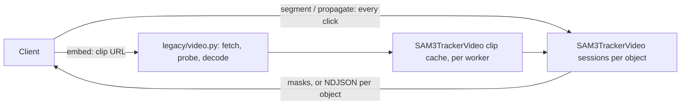

## Implementation plan: SAM3 offline video tracking routes

**Author:** Peter Robicheaux

**Related issue / PR:** branch [`peter/sam3-video-api`](https://github.com/roboflow/inference/tree/peter/sam3-video-api) (PR to follow)

## 1. What problem are we solving?

Interactive video annotation with SAM3: a user clicks the objects they want
in a clip, and SAM3 tracks those objects through the whole clip. They fix
the track by clicking again on any frame where it drifts, then track again.

What's missing today: the hosted SAM3 video path (the WebRTC workflow block)
prompts on the first frame only, and restarts object ids when prompted again.
So there is no way to add a correction click on frame 140 of a 300-frame clip
and get the whole track again, forward and backward from that click.

Example: a 25 s clip at 12 fps is 300 frames. The user clicks a dog on
frame 40, tracks, sees it jump to another dog on frame 210, and adds a click
there. Then they track again and get a mask on every frame. Each click
preview should come back in well under a second, and a track in seconds to a
minute or two.

## 2. How will the behaviour change?

### Before

### After

Four routes in `inference_server` (legacy router), backed by new offline
methods on `SAM3TrackerVideo` in `inference_models`:

- `POST /sam3/video/embed` fetches a clip (URL or base64) and decodes every
  frame. It keeps the preprocessed frames in the worker under the caller's
  `video_id`, scoped to the API key like SAM3 image embedding ids. With
  `encode_frames`, a background thread runs the image encoder on every frame,
  one frame per hold of the model lock, so other calls interleave.
- `POST /sam3/video/segment` returns one frame's masks for the objects
  clicked there, from all their clicks, with no propagation. This is the
  click preview.
- `POST /sam3/video/propagate` tracks every object over the whole clip. Each
  object gets its own session: its clicks are applied in frame order, then it
  propagates forward from its first clicked frame and backward from there. The
  reply is COCO RLE on the asked frames, once the whole clip is tracked.
- `POST /sam3/video/propagate/stream` tracks the same way and replies as
  NDJSON. Each object is one model call. An `object` line goes out as each
  object finishes, a `heartbeat` line after any 15 s without another line, and
  the last line is `done`, or `error` with the status and body the call would
  have failed with.

Every segment and propagate call carries all the clicks, so the server holds
no per-object state: only the clip, its preprocessed frames and the encoder
output of frames seen so far. The cache keeps `SAM3_VIDEO_MAX_CACHED_CLIPS`
clips per worker (default 4, least recently used evicted), and clips are capped
at `SAM3_VIDEO_MAX_FRAMES` (default 600). A call on a clip the worker doesn't
have answers 400 `No video embedded …`, and the caller embeds again. Losing a
clip costs a re-embed, never data.

Why this fits:

- Clip input reuses the action recognition video input in `legacy/video.py`:
  `video_source_path` (same URL policy and `MAX_VIDEO_DOWNLOAD_SIZE_MB`),
  `probe_video` (the frame cap is checked from the header before decoding)
  and the sequential `read_frame_windows`. Frames are decoded in order and
  never sought, so frame N is the same pixels the caller's player shows, as
  long as the caller sends an intra-frame format such as MJPEG AVI.
- The model methods go through the model manager like other actions
  (`registry_defaults.py` entries for `SAM3TrackerVideo`, params-only calls).
- The stream exists because the model manager returns whole results, not
  partial ones. Splitting the call per object gives progress without changing
  the manager. The heartbeat keeps proxies that end quiet replies (often
  after 60 to 100 s) from cutting a long track.

The same four routes, with the same request and response contract (paths,
field names, status codes and NDJSON lines), also exist on the HTTP server of
the `inference` package (`inference/core/interfaces/http/http_api.py`, with the
handlers in `inference/core/interfaces/http/sam3_video.py`), because that is the
server deployments run today, while `inference_server` is not yet deployed.
There they are off unless `SAM3_VIDEO_ENABLED=true` (and
`CORE_MODEL_SAM3_ENABLED`, on by default), since only a deployment with one
worker process and sticky routing can serve them. That server loads the
tracker with `inference_models.AutoModel.from_pretrained` once per worker
process, on the first call, sharing the model manager's artifact cache like
the `roboflow_core/sam3_video@v1` block, and keeps it for the life of the
process. Clips come in through its own action recognition video input
(`inference/core/utils/video_utils.py`), which has the same URL policy, size
cap, probe and sequential decode.

Effects on existing users: none. The routes are new, the existing SAM3 video
block is untouched, and `SAM3TrackerVideo` only gains methods. The routes need
`SAM3_EXEC_MODE=local`, and answer 501 otherwise.

Deployment constraint: the clip lives in one worker process, so a deployment
needs `NUM_WORKERS=1` and sticky routing per caller (for example a load
balancer with cookie affinity). It does not suit stateless serverless
deployments.

Verification:

- Unit tests:
  - `inference_server/tests/unit_tests/legacy/test_router_sam3_video.py`: the routes, the stream's per-object lines, a mid-stream error line, heartbeats and stopping on close.
  - `tests/inference/unit_tests/core/interfaces/http/test_sam3_video_routes.py`: the same cases on the `inference` package's server, plus loading the tracker once, the access check and the route flag.
  - `inference_models/tests/unit_tests/models/test_sam3_tracker_video_offline.py`: the model methods and clip cache.
  - `inference_model_manager/tests/unit_tests/test_registry_defaults.py`.
- End to end: an annotation client was run against these routes on a GPU
  machine, embedding clips, previewing clicks and tracking full clips.

## 3. Uncertainties and decisions needing input

- **Question:** Should the stream go through the model manager a frame at a
  time instead of an object at a time?
  - **Investigation:** `LegacyModelBridge.infer` and the gateway return a
    finished result. The stream pipeline in `inference_model_manager` is for
    WebRTC frames, not partial results. No route in `inference_server` streams
    today.
  - **Recommendation:** one call per object, as built. It needs no manager
    change, and annotation typically tracks one to a few objects at a time.
  - **Input needed:** is partial-result streaming through the manager planned?
    If it is, the stream could move to it later without changing its lines.
    Not blocking.

- **Question:** Timeout and cancellation control.
  - **Investigation:** action recognition's `VideoProcessingControl` lives in
    the old `inference` package, which `inference_server` doesn't import. Draft
    [#3253](https://github.com/roboflow/inference/pull/3253) moves it into
    `inference_models.video.control`. For now, closing the stream cancels the
    tracking task. The object in flight finishes in the model, and the rest are
    not tracked. `INFERENCE_INFER_TIMEOUT_S` limits each model call, so one
    object on the stream, or the whole clip on `/propagate`.
  - **Recommendation:** ship without it, and switch to
    `VideoProcessingControl` once #3253 lands.
  - **Input needed:** none.

- **Question:** Memory per cached clip.
  - **Investigation:** a clip keeps its preprocessed frames and its encoder
    output in CPU memory, and moves features to the GPU per use. In bfloat16
    that is about 6 MB of preprocessed pixels per frame, plus about 11 MB of
    encoder output once the frame is encoded (the model reduces the channels
    of the two high-resolution maps before they are kept). This is computed,
    not measured. A 480-frame clip is about 8 GB when every frame is encoded,
    so CPU memory, not the GPU, limits how many clips a server keeps.
  - **Recommendation:** size `SAM3_VIDEO_MAX_CACHED_CLIPS` and
    `SAM3_VIDEO_MAX_FRAMES` to the machine's RAM (the defaults, 4 clips of up
    to 600 frames, allow about 40 GB), and measure before raising either.
  - **Input needed:** none, but it is open until measured.

- **Question:** Clips shorter than two frames.
  - **Investigation:** reusing `probe_video` brings its rule that a clip needs
    at least two frames, with a message that talks about actions.
  - **Recommendation:** keep it. A one-frame clip isn't a tracking input, and
    `/sam3/concept_segment` covers still images.
  - **Input needed:** whether the shared message should drop the word "action". Not blocking.
